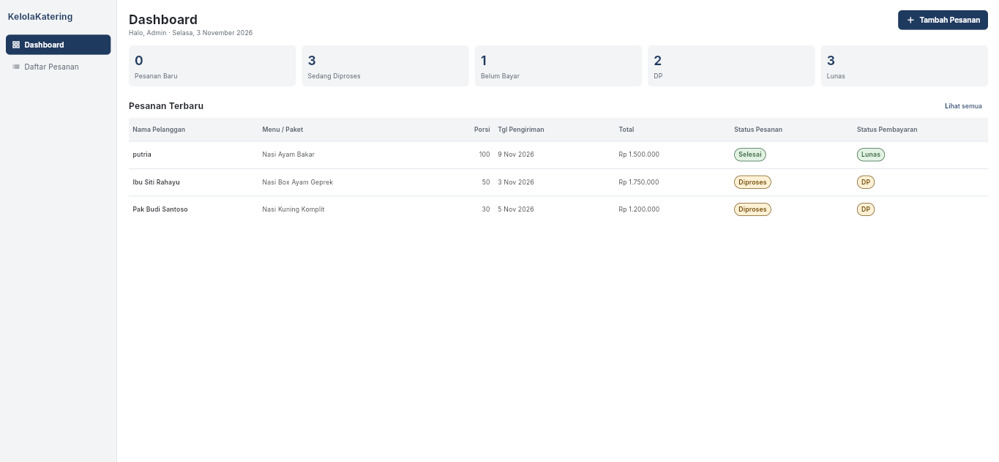
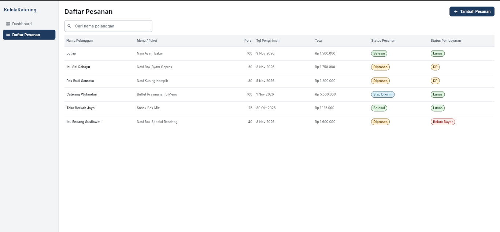
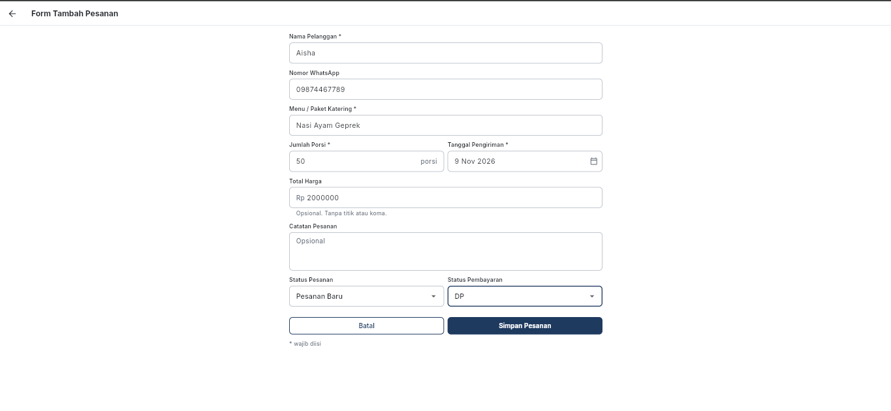
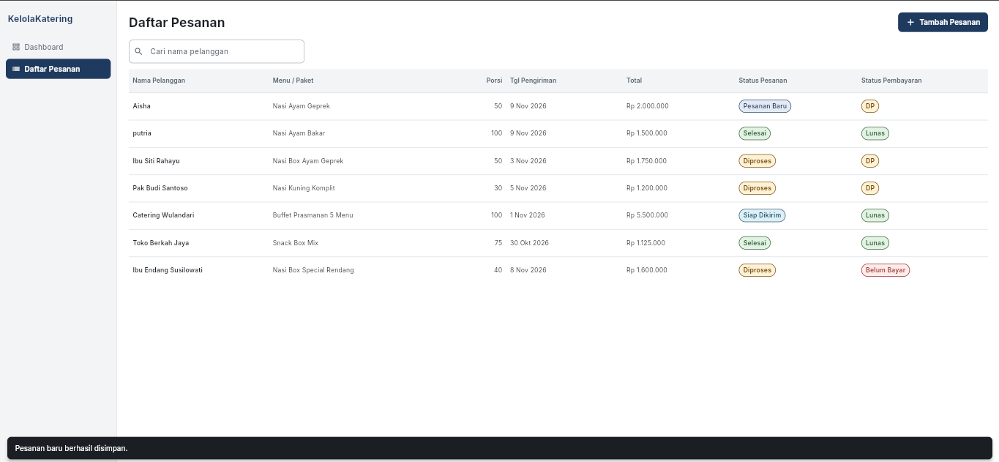
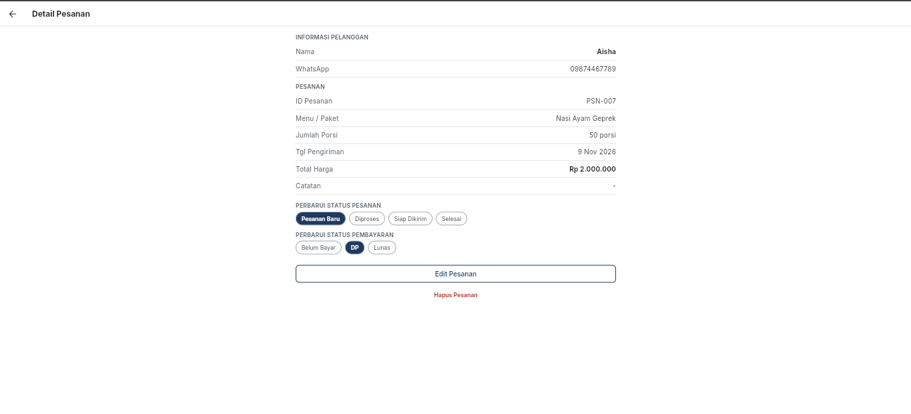
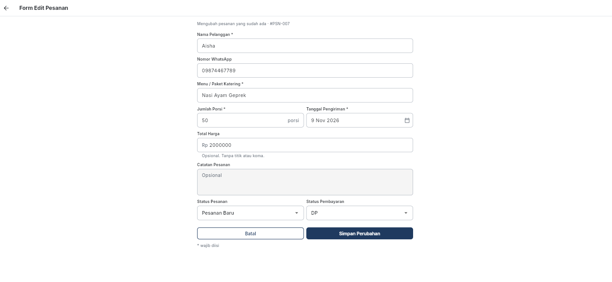
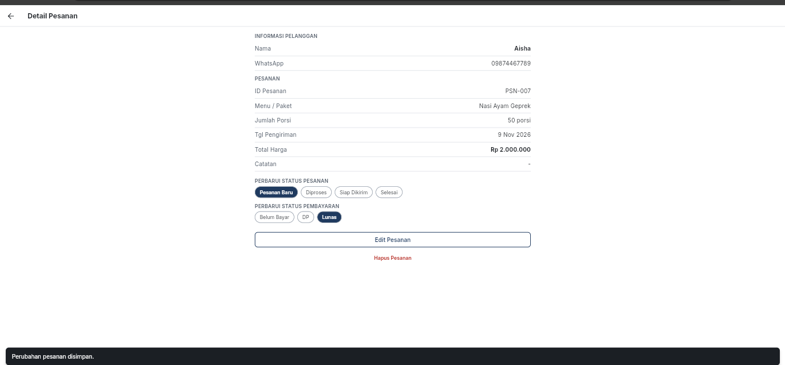
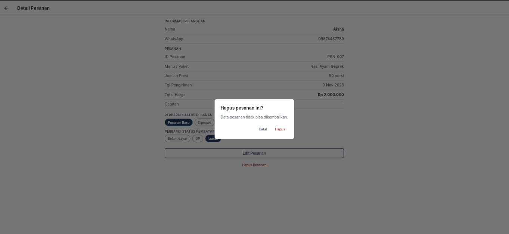

# KelolaKatering

Aplikasi Flutter untuk mencatat pesanan katering UMKM. Selama ini pesanan
masuk lewat WhatsApp lalu ditulis ulang ke buku atau spreadsheet. Di
aplikasi ini admin mencatat pesanan di satu tempat, lalu memantau status
pesanan dan status pembayarannya.

Penggunanya hanya admin atau pemilik katering. Pelanggan tidak login dan
tetap memesan lewat WhatsApp.

Proyek individu mata kuliah Mobile and Web Application Development,
Sistem Informasi, Universitas Stikubank.

## Identitas

| | |
|---|---|
| Nama | Putria Tri Ariibah |
| NIM | 23.01.55.0011 |
| Kelas | A1 |
| Judul aplikasi | KelolaKatering: Aplikasi Pencatatan Pesanan Katering |
| Rancangan Figma | [KelolaKatering Wireframe](https://www.figma.com/design/OyxsoD8sEsPeDLm1hT4DNS/KelolaKatering-%E2%80%94-Wireframe-Baru-Modul-1%E2%80%933?node-id=0-1) |
| Video presentasi UTS | [youtu.be/GexeyTzHPTQ](https://youtu.be/GexeyTzHPTQ) |

## Fitur

- Dashboard: jumlah pesanan baru dan yang sedang diproses, ringkasan
  pembayaran (Belum Bayar, DP, Lunas), dan tiga pesanan terbaru.
- Daftar Pesanan: semua pesanan, bisa dicari berdasarkan nama pelanggan.
- Masuk dan Daftar akun admin dengan Firebase Authentication. Saat
  daftar, admin mengisi nama lengkap yang dipakai untuk sapaan di
  Dashboard.
- Detail Pesanan: data pelanggan, data pesanan, status pesanan, dan
  status pembayaran.
- Form Tambah Pesanan dengan validasi di setiap kolom. Menu diketik
  bebas, dengan saran dari daftar menu yang tersimpan. Pesanan yang sama
  (nama pelanggan, menu, dan tanggal kirim sama) ditolak.
- Data pesanan tersimpan di Cloud Firestore, tampil real-time, dan tetap
  ada setelah halaman dimuat ulang.
- Ubah status, edit, dan hapus pesanan sedang disambungkan ke Firestore
  (Minggu 11). Untuk sementara tombolnya disembunyikan dari Detail
  Pesanan; screenshot Form Edit dan konfirmasi hapus di bawah berasal
  dari versi sebelum Firestore.
- Tampilan menyesuaikan lebar layar. Di ponsel menu ada di bawah dan
  pesanan tampil sebagai kartu. Di browser (lebar 600 px ke atas) menu
  pindah ke sidebar kiri dan pesanan tampil sebagai tabel.

## Tampilan

Semua screenshot diambil dari versi web di Chrome dengan data simulasi.

### Dashboard



### Daftar Pesanan



### Form Tambah Pesanan



Setelah disimpan, pesanan baru muncul di urutan paling atas:



### Detail Pesanan



### Form Edit Pesanan



Detail Pesanan setelah status pembayaran diganti menjadi Lunas lewat
Form Edit Pesanan:



### Konfirmasi hapus



## Status pesanan dan pembayaran

| Status pesanan | Arti |
|----------------|------|
| Pesanan Baru | Pesanan baru masuk |
| Diproses | Sedang disiapkan atau dimasak |
| Siap Dikirim | Sudah siap diantar |
| Selesai | Sudah dikirim |

| Status pembayaran | Arti |
|-------------------|------|
| Belum Bayar | Belum ada pembayaran |
| DP | Uang muka sudah diterima |
| Lunas | Sudah dibayar penuh |

## Aturan validasi form

Form memakai `Form` dengan `GlobalKey<FormState>`, jadi semua kolom
diperiksa sekaligus saat tombol simpan ditekan. Pesan kesalahan muncul
di bawah kolom yang salah.

| Kolom | Aturan | Pesan kesalahan |
|-------|--------|-----------------|
| Nama Pelanggan | Wajib, 3 sampai 60 karakter | Nama pelanggan wajib diisi |
| Nomor WhatsApp | Opsional. Jika diisi: 10 sampai 15 digit, diawali 0 | Nomor WhatsApp harus 10-15 digit dan diawali angka 0 |
| Menu / Paket Katering | Wajib, 3 sampai 80 karakter | Menu wajib diisi |
| Jumlah Porsi | Wajib, 1 sampai 1000 | Jumlah porsi tidak boleh nol / Jumlah porsi maksimal 1000 porsi |
| Tanggal Pengiriman | Wajib, hari ini sampai 365 hari ke depan | Tanggal pengiriman wajib diisi |
| Total Harga | Opsional. Jika diisi: lebih dari 0, paling besar Rp 100.000.000 | Total harga harus lebih dari nol |
| Catatan Pesanan | Opsional, paling banyak 200 karakter | Catatan maksimal 200 karakter |
| Status Pesanan | Dipilih dari daftar, awalnya Pesanan Baru | |
| Status Pembayaran | Dipilih dari daftar, awalnya Belum Bayar | |

Tanggal dipilih lewat `showDatePicker`. Tanggal yang sudah lewat tidak
bisa dipilih, kecuali saat mengedit pesanan yang tanggalnya memang sudah
lewat.

## Penyimpanan data (Cloud Firestore)

Mulai Minggu 10 data disimpan di Cloud Firestore (project Firebase
`kelolakatering-2301550011`, paket Spark). Strukturnya mengikuti tiga
collection:

| Collection | Document ID | Field | Kegunaan |
|---|---|---|---|
| `users` | uid Firebase Auth | `id_pengguna`, `nama_lengkap`, `email`, `nomor_telepon`, `peran`, `dibuat_pada` | Profil admin, dibuat saat daftar atau masuk |
| `menus` | kode menu, mis. `menu-ayam-geprek` | `id_menu`, `nama_menu`, `harga_per_porsi` | Daftar menu untuk saran di form, diisi otomatis sekali bila masih kosong |
| `orders` | auto-ID | `id_pesanan`, `id_pengguna`, `nama_pelanggan`, `nomor_hp`, `id_menu`, `nama_menu`, `jumlah_porsi`, `tanggal_kirim`, `total_harga`, `catatan`, `status_pesanan`, `status_pembayaran`, `dibuat_pada` | Setiap pesanan yang dicatat admin |

- `orders.id_pengguna` menunjuk ke `users`, dan `orders.id_menu` menunjuk
  ke `menus`. `id_menu` kosong bila menu diketik sendiri dan belum ada di
  `menus`.
- `nama_menu` ikut disalin ke `orders` (denormalisasi) karena Firestore
  tidak punya JOIN, sehingga daftar pesanan cukup dibaca dari satu
  collection.
- Daftar pesanan dibaca dengan
  `.where('id_pengguna', isEqualTo: uid).snapshots()`, lalu diurutkan dari
  yang terbaru di sisi Dart agar tidak memerlukan composite index.
- Security Rules hanya mengizinkan pengguna yang sudah login:

```
rules_version = '2';
service cloud.firestore {
  match /databases/{database}/documents {
    match /{document=**} {
      allow read, write: if request.auth != null;
    }
  }
}
```

Halaman tidak memanggil Firestore secara langsung, tetapi lewat
`lib/services/layanan_firestore.dart`. Aplikasi memakai `LayananFirestore`,
sedangkan widget test memakai `LayananMemori` sehingga test tidak
membutuhkan internet.

## Teknologi

- Flutter dan Dart, Material 3
- Font Inter yang disimpan di `assets/fonts/` (lisensi SIL Open Font
  License)
- Warna dan ukuran teks mengikuti mini style guide di Figma: warna
  primer #1F3A5F, ukuran teks 26, 18, 15, dan 13
- Firebase: `firebase_core` 5.1.0, `firebase_auth` 7.0.1, dan
  `cloud_firestore` 7.1.0, paket Spark tanpa billing account.
- Format tanggal dan Rupiah dibuat sendiri di `lib/utils/format.dart`.

## Struktur proyek

```
lib/
  main.dart                          # KelolaKateringApp dan HomeShell (navigasi)
  firebase_options.dart              # Konfigurasi Firebase web
  data/mock_data.dart                # Data simulasi (dipakai Form Edit, Minggu 11)
  data/menu_awal.dart                # Lima menu awal untuk collection menus
  models/pesanan_model.dart          # Model Pesanan, enum status, toMap/fromMap
  models/pengguna_model.dart         # Model profil admin (users)
  models/menu_model.dart             # Model menu (menus)
  services/layanan_firestore.dart    # LayananFirestore dan LayananMemori
  screens/
    cek_status_login.dart            # Halaman Masuk atau HomeShell sesuai login
    masuk_screen.dart                # Masuk dan Daftar
    dashboard_screen.dart
    daftar_pesanan_screen.dart
    detail_pesanan_screen.dart
    tambah_pesanan_screen.dart       # Form Tambah dan Form Edit Pesanan
  utils/
    theme.dart                       # Tema dari style guide Figma
    format.dart                      # Format tanggal dan Rupiah
  widgets/
    empty_state.dart
    pesanan_card.dart                # Kartu pesanan (ponsel)
    pesanan_table.dart               # Tabel pesanan (layar lebar)
    ringkasan_pembayaran_card.dart
    sidebar_menu.dart                # Menu samping (layar lebar)
    status_badge.dart
    summary_card.dart
    tombol_tambah_pesanan.dart
assets/fonts/                        # Font Inter dan lisensinya
test/
  widget_test.dart                   # Halaman awal
  masuk_test.dart                    # Masuk, Daftar, dan Nama lengkap
  tambah_pesanan_test.dart           # Validasi form, simpan ke orders, pesanan ganda
  detail_pesanan_test.dart           # Tampilan dari orders, isolasi akun, pencarian
```

## Menjalankan aplikasi

```bash
flutter pub get
flutter run -d chrome
```

Untuk melihat tampilan ponsel, kecilkan jendela Chrome sampai lebarnya di
bawah 600 px.

## Pengujian

```bash
flutter analyze
flutter test
```

`flutter analyze` tidak menemukan masalah, dan 30 test lulus.

### Tabel uji form

| No | Yang diuji | Hasil yang diharapkan |
|----|------------|-----------------------|
| 1 | Simpan form kosong | Pesan wajib diisi muncul, data tidak bertambah |
| 2 | Jumlah porsi 0 | "Jumlah porsi tidak boleh nol" |
| 3 | Jumlah porsi 5000 | "Jumlah porsi maksimal 1000 porsi" |
| 4 | Nomor WhatsApp 0812 | Pesan format nomor salah |
| 5 | Semua kolom benar | Tersimpan ke collection `orders` |
| 6 | Pesanan yang sama dicatat ulang | Ditolak, form tetap terbuka |
| 7 | Menu lain untuk pelanggan yang sama | Tetap tersimpan |
| 8 | Menu diketik sendiri | Tersimpan dengan `id_menu` kosong |
| 9 | Ketik "snack" di kolom Menu | Saran "Snack Box Mix" muncul dan dapat dipilih |
| 10 | Pesanan baru | Langsung tampil di Dashboard dan Daftar Pesanan |
| 11 | Cari "budi" lalu "zzz" | Hanya Pak Budi Santoso, lalu "Pesanan tidak ditemukan" |
| 12 | Buka aplikasi | Dashboard tampil sebagai halaman awal |

### Tabel uji Cloud Firestore (Minggu 10)

Diuji di Chrome dan Firebase Console pada 17–18 November 2026.

| No | Kasus uji | Langkah | Hasil yang diharapkan | Hasil nyata |
|----|-----------|---------|-----------------------|-------------|
| 1 | Tambah data valid | Kirim Form Tambah Pesanan dengan isian lengkap | Dokumen tampil di `orders` dan di Daftar Pesanan | Sesuai: pesanan SD Islam Al Madina tersimpan di `orders` dan tampil paling atas |
| 2 | Tolak pesanan ganda | Catat ulang pelanggan, menu, dan tanggal kirim yang sama | Muncul pesan sudah tercatat; dokumen tidak bertambah | Sesuai: "Pesanan Mama Aisya untuk Nasi Ayam Bali pada tanggal itu sudah tercatat." |
| 3 | Bertahan saat refresh | Muat ulang halaman Chrome | Sapaan nama dan daftar pesanan tetap tampil | Sesuai |
| 4 | Isolasi antar akun | Keluar lalu masuk dengan akun kedua | Pesanan akun pertama tidak muncul | Sesuai: akun admin@kelolakatering.id menampilkan "Belum ada pesanan" |
| 5 | Security Rules | Rules Playground: `get orders/{id}` tanpa login | Akses ditolak | Sesuai: "Simulated read denied" |

## Repository

https://github.com/putriatri0011/KelolaKatering
