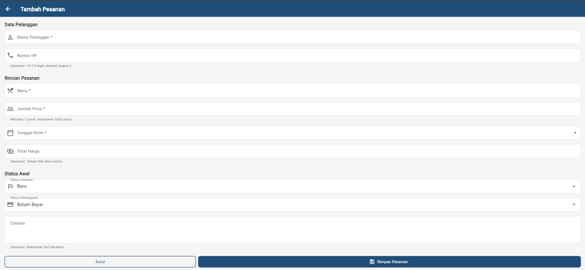

# KelolaKatering

Aplikasi pencatatan pesanan katering untuk UMKM katering berbasis Flutter.
Membantu pemilik usaha katering mencatat dan memantau pesanan serta status
pembayaran dalam satu aplikasi, menggantikan pencatatan manual via WhatsApp
atau buku/catatan terpisah.

## Fitur yang Sudah Diimplementasikan

- **Dashboard** — menampilkan ringkasan jumlah pesanan baru dan pesanan
  diproses, serta daftar 3 pesanan terbaru.
- **Daftar Pesanan** — menampilkan seluruh pesanan dalam bentuk kartu
  dengan informasi nama pelanggan, menu, jumlah porsi, tanggal kirim,
  status pesanan, dan status pembayaran.
- **Detail Pesanan** — menampilkan informasi lengkap satu pesanan meliputi
  ID, nama pelanggan, nomor HP, menu, jumlah porsi, tanggal kirim, total
  harga, catatan, status pesanan, dan status pembayaran.
- **Form Tambah Pesanan** — formulir untuk mencatat pesanan baru lengkap
  dengan validasi input dan pesan kesalahan per kolom. Pesanan yang valid
  langsung tampil di Dashboard dan Daftar Pesanan.
- **Navigasi antar halaman** — Dashboard dan Daftar Pesanan terhubung
  melalui NavigationBar (Material 3); kartu pesanan dapat ditekan untuk
  membuka halaman Detail Pesanan.
- **Empty state** — menampilkan ilustrasi dan pesan ketika tidak ada
  data pesanan.
- **Data simulasi** — 5 pesanan fiktif sebagai data contoh, ditambah
  pesanan baru yang disimpan di memori selama aplikasi berjalan (tidak
  menggunakan database atau layanan eksternal).

### Status Pesanan

| Status | Keterangan |
|--------|------------|
| Baru | Pesanan baru masuk |
| Diproses | Pesanan sedang diproses/dimasak |
| Siap Dikirim | Pesanan siap untuk dikirim |
| Selesai | Pesanan selesai dan telah dikirim |

### Status Pembayaran

| Status | Keterangan |
|--------|------------|
| Belum Bayar | Pembayaran belum diterima |
| DP | Uang muka / DP diterima |
| Lunas | Pembayaran lunas |

## Form Tambah Pesanan

Form dibuka dari tombol **+** di Dashboard maupun di Daftar Pesanan.
Halamannya berupa `StatefulWidget` dengan `Form` dan
`GlobalKey<FormState>`, sehingga seluruh kolom divalidasi sekaligus saat
tombol **Simpan Pesanan** ditekan. Setiap pesan kesalahan tampil tepat di
bawah kolom yang bermasalah, bukan sebagai pesan umum.

### Kolom dan Aturan Validasi

| Kolom | Widget | Aturan | Pesan kesalahan |
|-------|--------|--------|-----------------|
| Nama Pelanggan | `TextFormField` | Wajib; 3–60 karakter | Nama pelanggan wajib diisi / Nama pelanggan minimal 3 karakter |
| Nomor HP | `TextFormField` (angka) | Opsional; 10–15 digit, diawali 0 | Nomor HP harus 10-15 digit dan diawali angka 0 |
| Menu | `TextFormField` | Wajib; 3–80 karakter | Menu wajib diisi / Menu minimal 3 karakter |
| Jumlah Porsi | `TextFormField` (angka) | Wajib; 1–1000 porsi | Jumlah porsi tidak boleh nol / Jumlah porsi maksimal 1000 porsi |
| Tanggal Kirim | `TextFormField` read-only + `showDatePicker` | Wajib; hari ini s.d. 365 hari ke depan | Tanggal kirim wajib diisi |
| Total Harga | `TextFormField` (angka) | Opsional; > 0 dan ≤ Rp 100.000.000 | Total harga harus lebih dari nol |
| Status Pesanan | `DropdownButtonFormField` | Default: Baru | — |
| Status Pembayaran | `DropdownButtonFormField` | Default: Belum Bayar | — |
| Catatan | `TextFormField` (multiline) | Opsional; maksimal 200 karakter | Catatan maksimal 200 karakter |

Kolom angka memakai `keyboardType: TextInputType.number` dan
`FilteringTextInputFormatter.digitsOnly`. Pada pemilih tanggal, batas
`firstDate` dan `lastDate` sekaligus berfungsi sebagai validasi karena
tanggal yang sudah lewat tidak dapat dipilih.

### Pesan Status

- **Berhasil** — SnackBar "Pesanan baru berhasil disimpan." muncul di
  halaman pemanggil setelah form ditutup.
- **Gagal** — SnackBar "Periksa kembali isian yang ditandai merah."
  muncul dan data tidak disimpan.
- `hideCurrentSnackBar()` dipanggil lebih dulu agar pesan baru tidak
  antre di belakang pesan sebelumnya.
- `autovalidateMode: AutovalidateMode.onUserInteraction` membuat pesan
  kesalahan ikut diperbarui saat pengguna memperbaiki isian.

### Penyimpanan Data Sementara

Data disimpan pada satu list di memori (`MockData.pesananList`) yang
dipakai bersama oleh Dashboard dan Daftar Pesanan. Setelah form ditutup,
`HomeShell` memanggil `setState()` sehingga kedua halaman langsung
menampilkan pesanan baru di urutan teratas dan angka ringkasan ikut
diperbarui.

Karena data hanya berada di memori aplikasi yang sedang berjalan, pesanan
baru **hilang ketika aplikasi dijalankan ulang** dan daftar kembali ke
lima pesanan simulasi awal. Penyimpanan permanen (database) belum
termasuk pada modul ini.

## Teknologi yang Digunakan

- **Flutter** (Dart) — framework UI cross-platform
- **Material 3** — sistem desain dengan ColorScheme kustom
- **Warna primer:** #1F4E79 (biru navy)
- **Tidak menggunakan Firebase** — data berasal dari simulasi in-memory
- **Tidak menggunakan package pihak ketiga** — hanya Flutter SDK dan
  `cupertino_icons`
- **Tanpa package `intl`** — format tanggal dan rupiah diimplementasikan
  manual

## Struktur Proyek

```
lib/
  main.dart                          # Entry point + HomeShell (NavigationBar)
  data/
    mock_data.dart                   # List pesanan simulasi (mutable, dipakai bersama)
  models/
    pesanan_model.dart               # Model Pesanan + enum status
  screens/
    dashboard_screen.dart            # Halaman Dashboard
    daftar_pesanan_screen.dart       # Halaman Daftar Pesanan
    detail_pesanan_screen.dart       # Halaman Detail Pesanan
    tambah_pesanan_screen.dart       # Form Tambah Pesanan + validasi
  utils/
    theme.dart                       # Tema Material 3 (AppTheme)
  widgets/
    summary_card.dart                # Kartu ringkasan jumlah
    status_badge.dart                # Badge status pesanan/pembayaran
    empty_state.dart                 # Tampilan kosong
    pesanan_card.dart                # Kartu pesanan

test/
  widget_test.dart                   # Uji tampilan awal aplikasi
  tambah_pesanan_test.dart           # Uji form: validasi & penyimpanan data
```

## Cara Menjalankan Aplikasi

1. Pastikan Flutter SDK sudah terinstal (`flutter --version`).
2. Buka terminal di folder proyek.
3. Jalankan perintah berikut:

```bash
flutter pub get
flutter run
```

4. Pilih perangkat target (Chrome, Windows, Android emulator, dll).

### Menjalankan di Web (Chrome)

```bash
flutter run -d chrome
```

### Menjalankan di Desktop (Windows)

```bash
flutter run -d windows
```

## Analisis Kode

Untuk memeriksa kualitas kode:

```bash
flutter analyze
```

Hasil: **No issues found!**

## Pengujian Otomatis

```bash
flutter test
```

Hasil: **7 test lulus, 0 gagal** — 6 kasus uji form dan 1 uji tampilan awal
aplikasi.

| # | Kasus uji | Hasil yang diharapkan |
|---|-----------|----------------------|
| 1 | Semua kolom kosong | Empat pesan kolom wajib muncul, data tidak bertambah |
| 2 | Jumlah porsi `0` | "Jumlah porsi tidak boleh nol" |
| 3 | Jumlah porsi `5000` | "Jumlah porsi maksimal 1000 porsi" |
| 4 | Nomor HP `0812` | "Nomor HP harus 10-15 digit dan diawali angka 0" |
| 5 | Semua kolom valid | Pesanan tersimpan sebagai `PSN-006` dengan nilai yang benar |
| 6 | Alur penuh | Pesanan baru tampil di Dashboard dan Daftar Pesanan |

## Screenshot

### Dashboard


### Daftar Pesanan


### Detail Pesanan


### Form Tambah Pesanan



## Repository

https://github.com/putriatri0011/KelolaKatering
