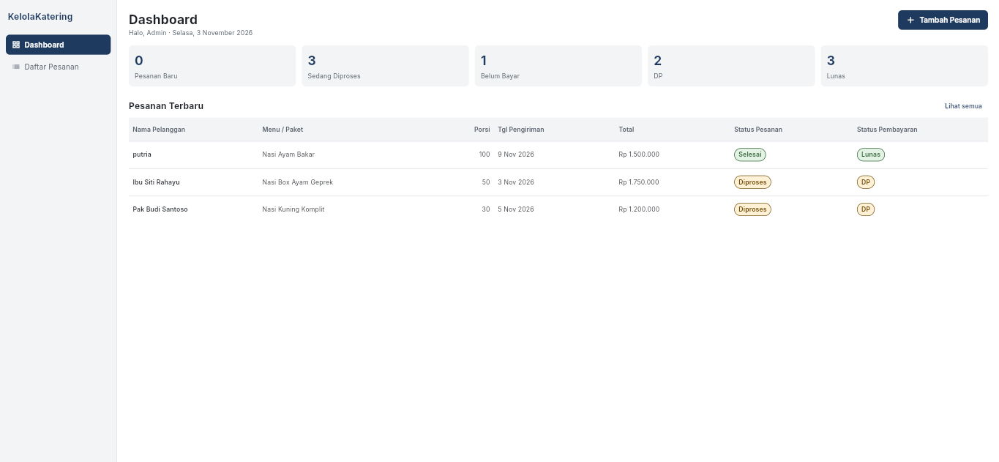
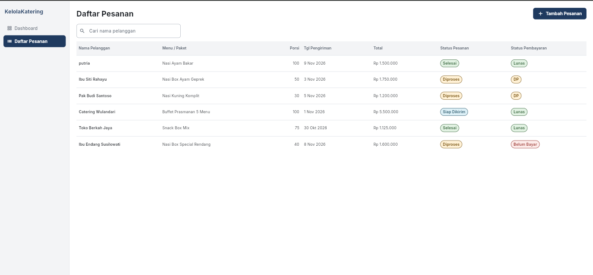
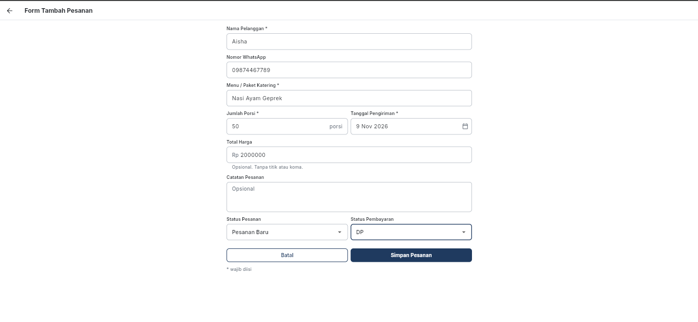
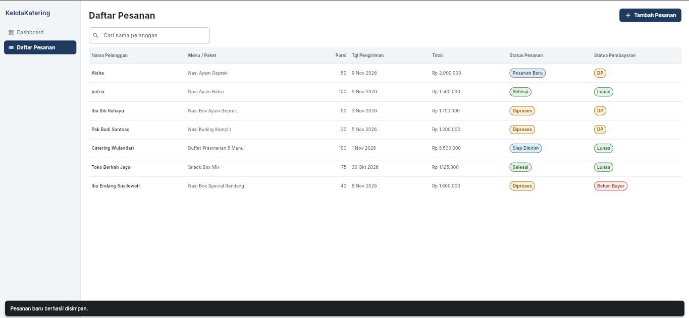
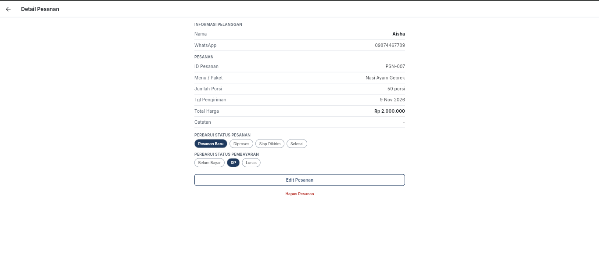
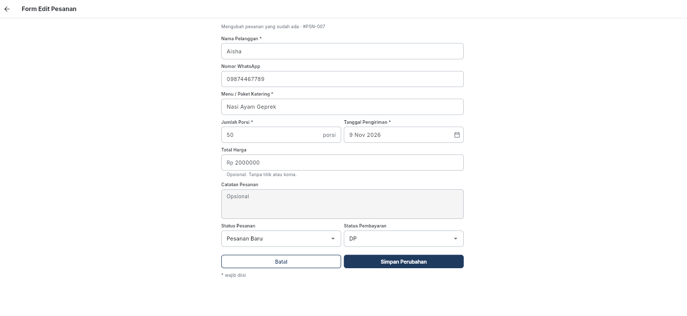
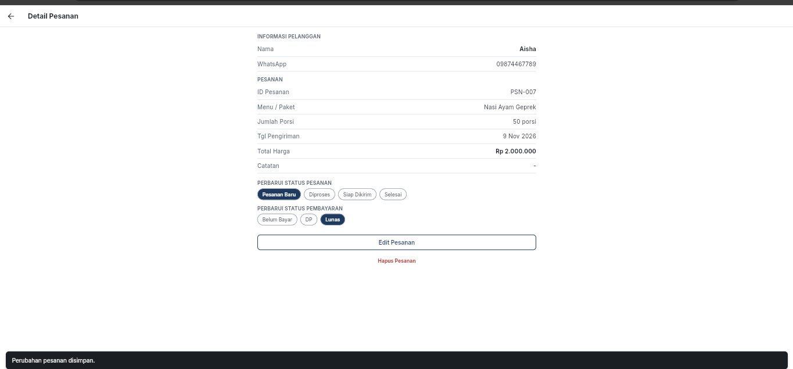
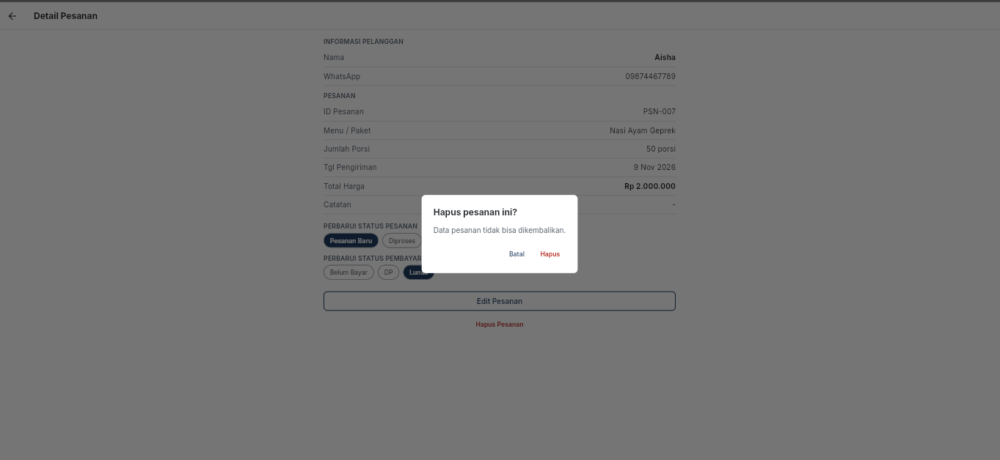

# KelolaKatering

Aplikasi Flutter untuk mencatat pesanan katering UMKM. Selama ini pesanan
masuk lewat WhatsApp lalu ditulis ulang ke buku atau spreadsheet. Di
aplikasi ini admin mencatat pesanan di satu tempat, lalu memantau status
pesanan dan status pembayarannya.

Penggunanya hanya admin atau pemilik katering. Pelanggan tidak login dan
tetap memesan lewat WhatsApp.

Proyek individu mata kuliah Mobile and Web Application Development,
Sistem Informasi, Universitas Stikubank.

## Identitas

| | |
|---|---|
| Nama | Putria Tri Ariibah |
| NIM | 23.01.55.0011 |
| Kelas | A1 |
| Judul aplikasi | KelolaKatering: Aplikasi Pencatatan Pesanan Katering |
| Rancangan Figma | [KelolaKatering Wireframe](https://www.figma.com/design/OyxsoD8sEsPeDLm1hT4DNS/KelolaKatering-%E2%80%94-Wireframe-Baru-Modul-1%E2%80%933?node-id=0-1) |
| Video presentasi UTS | [youtu.be/GexeyTzHPTQ](https://youtu.be/GexeyTzHPTQ) |

## Fitur

- Dashboard: jumlah pesanan baru dan yang sedang diproses, ringkasan
  pembayaran (Belum Bayar, DP, Lunas), dan tiga pesanan terbaru.
- Daftar Pesanan: semua pesanan, bisa dicari berdasarkan nama pelanggan.
- Detail Pesanan: data pelanggan dan pesanan. Status pesanan dan status
  pembayaran diubah dengan menekan pilihan yang tersedia, dan langsung
  tersimpan.
- Form Tambah Pesanan dan Form Edit Pesanan: satu formulir untuk
  mencatat pesanan baru atau mengubah pesanan lama, dengan validasi di
  setiap kolom.
- Hapus pesanan, dengan konfirmasi lebih dulu.
- Tampilan menyesuaikan lebar layar. Di ponsel menu ada di bawah dan
  pesanan tampil sebagai kartu. Di browser (lebar 600 px ke atas) menu
  pindah ke sidebar kiri dan pesanan tampil sebagai tabel.

## Tampilan

Semua screenshot diambil dari versi web di Chrome dengan data simulasi.

### Dashboard



### Daftar Pesanan



### Form Tambah Pesanan



Setelah disimpan, pesanan baru muncul di urutan paling atas:



### Detail Pesanan



### Form Edit Pesanan



Detail Pesanan setelah status pembayaran diganti menjadi Lunas lewat
Form Edit Pesanan:



### Konfirmasi hapus



## Status pesanan dan pembayaran

| Status pesanan | Arti |
|----------------|------|
| Pesanan Baru | Pesanan baru masuk |
| Diproses | Sedang disiapkan atau dimasak |
| Siap Dikirim | Sudah siap diantar |
| Selesai | Sudah dikirim |

| Status pembayaran | Arti |
|-------------------|------|
| Belum Bayar | Belum ada pembayaran |
| DP | Uang muka sudah diterima |
| Lunas | Sudah dibayar penuh |

## Aturan validasi form

Form memakai `Form` dengan `GlobalKey<FormState>`, jadi semua kolom
diperiksa sekaligus saat tombol simpan ditekan. Pesan kesalahan muncul
di bawah kolom yang salah.

| Kolom | Aturan | Pesan kesalahan |
|-------|--------|-----------------|
| Nama Pelanggan | Wajib, 3 sampai 60 karakter | Nama pelanggan wajib diisi |
| Nomor WhatsApp | Opsional. Jika diisi: 10 sampai 15 digit, diawali 0 | Nomor WhatsApp harus 10-15 digit dan diawali angka 0 |
| Menu / Paket Katering | Wajib, 3 sampai 80 karakter | Menu wajib diisi |
| Jumlah Porsi | Wajib, 1 sampai 1000 | Jumlah porsi tidak boleh nol / Jumlah porsi maksimal 1000 porsi |
| Tanggal Pengiriman | Wajib, hari ini sampai 365 hari ke depan | Tanggal pengiriman wajib diisi |
| Total Harga | Opsional. Jika diisi: lebih dari 0, paling besar Rp 100.000.000 | Total harga harus lebih dari nol |
| Catatan Pesanan | Opsional, paling banyak 200 karakter | Catatan maksimal 200 karakter |
| Status Pesanan | Dipilih dari daftar, awalnya Pesanan Baru | |
| Status Pembayaran | Dipilih dari daftar, awalnya Belum Bayar | |

Tanggal dipilih lewat `showDatePicker`. Tanggal yang sudah lewat tidak
bisa dipilih, kecuali saat mengedit pesanan yang tanggalnya memang sudah
lewat.

## Penyimpanan data

Data masih berupa list di memori (`MockData.pesananList`) berisi lima
pesanan simulasi. `MockData` menyediakan fungsi `tambah`, `perbarui`,
`hapus`, `cariById`, dan `cariNama`. Setiap kali form atau Detail Pesanan
ditutup, `HomeShell` memanggil `setState()` supaya Dashboard dan Daftar
Pesanan menampilkan data terbaru.

Karena hanya disimpan di memori, semua perubahan hilang saat aplikasi
dijalankan ulang. Penyimpanan permanen dengan Cloud Firestore
direncanakan setelah UTS.

## Teknologi

- Flutter dan Dart, Material 3
- Font Inter yang disimpan di `assets/fonts/` (lisensi SIL Open Font
  License)
- Warna dan ukuran teks mengikuti mini style guide di Figma: warna
  primer #1F3A5F, ukuran teks 26, 18, 15, dan 13
- Belum memakai Firebase dan belum memakai package tambahan dari pub.dev.
  Format tanggal dan Rupiah dibuat sendiri di `lib/utils/format.dart`.

## Struktur proyek

```
lib/
  main.dart                          # KelolaKateringApp dan HomeShell (navigasi)
  data/mock_data.dart                # Data simulasi dan fungsi pengelolanya
  models/pesanan_model.dart          # Model Pesanan, enum status
  screens/
    dashboard_screen.dart
    daftar_pesanan_screen.dart
    detail_pesanan_screen.dart
    tambah_pesanan_screen.dart       # Form Tambah dan Form Edit Pesanan
  utils/
    theme.dart                       # Tema dari style guide Figma
    format.dart                      # Format tanggal dan Rupiah
  widgets/
    empty_state.dart
    pesanan_card.dart                # Kartu pesanan (ponsel)
    pesanan_table.dart               # Tabel pesanan (layar lebar)
    ringkasan_pembayaran_card.dart
    sidebar_menu.dart                # Menu samping (layar lebar)
    status_badge.dart
    summary_card.dart
    tombol_tambah_pesanan.dart
assets/fonts/                        # Font Inter dan lisensinya
test/
  widget_test.dart                   # Halaman awal
  tambah_pesanan_test.dart           # Validasi dan penyimpanan form
  detail_pesanan_test.dart           # Ubah status, edit, hapus, pencarian
```

## Menjalankan aplikasi

```bash
flutter pub get
flutter run -d chrome
```

Untuk melihat tampilan ponsel, kecilkan jendela Chrome sampai lebarnya di
bawah 600 px.

## Pengujian

```bash
flutter analyze
flutter test
```

`flutter analyze` tidak menemukan masalah, dan 13 test lulus.

| No | Yang diuji | Hasil yang diharapkan |
|----|------------|-----------------------|
| 1 | Simpan form kosong | Pesan wajib diisi muncul, data tidak bertambah |
| 2 | Jumlah porsi 0 | "Jumlah porsi tidak boleh nol" |
| 3 | Jumlah porsi 5000 | "Jumlah porsi maksimal 1000 porsi" |
| 4 | Nomor WhatsApp 0812 | Pesan format nomor salah |
| 5 | Semua kolom benar | Tersimpan sebagai PSN-006 |
| 6 | Pesanan baru | Tampil di Dashboard dan Daftar Pesanan |
| 7 | Ubah status pesanan ke Diproses | Status berubah dan ada pesan konfirmasi |
| 8 | Ubah status pembayaran ke Lunas | Jumlah Lunas di Dashboard menjadi 3 |
| 9 | Edit nama dan jumlah porsi | Data berubah, ID tetap sama |
| 10 | Hapus lalu pilih Hapus | Pesanan hilang dari daftar |
| 11 | Hapus lalu pilih Batal | Pesanan tetap ada |
| 12 | Cari "budi" lalu "zzz" | Hanya Pak Budi Santoso, lalu "Pesanan tidak ditemukan" |
| 13 | Buka aplikasi | Dashboard tampil sebagai halaman awal |

## Repository

https://github.com/putriatri0011/KelolaKatering
