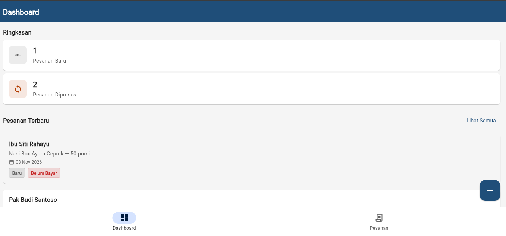
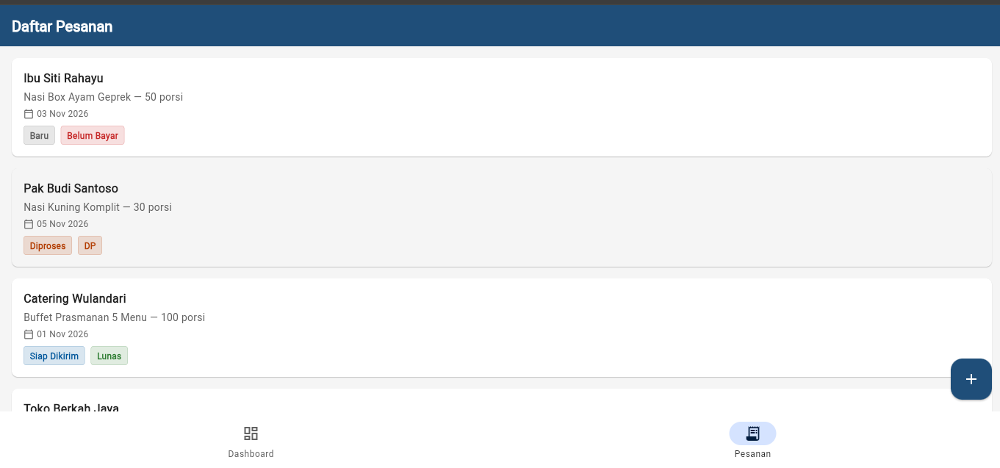
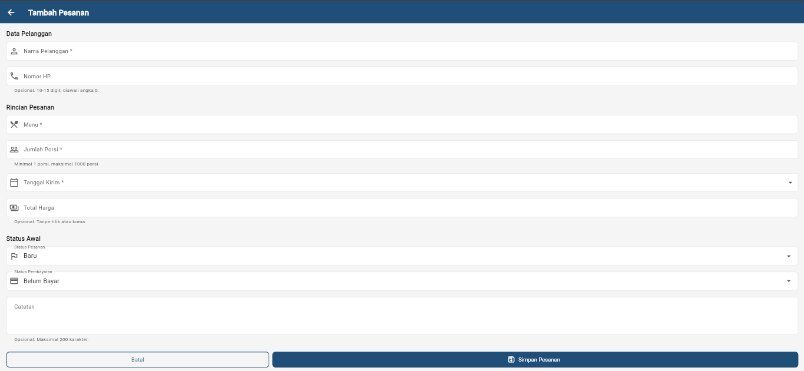

# KelolaKatering

Aplikasi pencatatan pesanan katering untuk UMKM katering berbasis Flutter.
Membantu pemilik usaha katering mencatat dan memantau pesanan serta status
pembayaran dalam satu aplikasi, menggantikan pencatatan manual via WhatsApp
atau buku/catatan terpisah.

## Fitur yang Sudah Diimplementasikan

- **Dashboard** — sapaan dan tanggal hari ini, jumlah Pesanan Baru dan
  Sedang Diproses, Ringkasan Pembayaran (Belum Bayar/DP/Lunas), serta
  3 pesanan terbaru dengan link "Lihat semua".
- **Daftar Pesanan** — seluruh pesanan dengan kolom **Cari nama
  pelanggan**. Setiap kartu memuat nama pelanggan, tanggal pengiriman,
  menu, jumlah porsi, total harga, status pesanan, dan status pembayaran.
- **Detail Pesanan** — informasi pelanggan dan pesanan, chip **Perbarui
  Status Pesanan** dan **Perbarui Status Pembayaran** (status langsung
  tersimpan), tombol **Edit Pesanan**, dan **Hapus Pesanan** dengan
  dialog konfirmasi.
- **Form Tambah Pesanan / Form Edit Pesanan** — satu formulir untuk
  mencatat pesanan baru maupun mengubah pesanan yang sudah ada, lengkap
  dengan validasi input dan pesan kesalahan per kolom.
- **Navigasi antar halaman** — di ponsel memakai NavigationBar di bawah;
  di layar lebar (≥ 600 px, mis. browser) memakai sidebar di kiri dengan
  menu dan urutan yang sama. Kartu atau baris pesanan membuka Detail
  Pesanan.
- **Tampilan web** — pada layar lebar, Dashboard dan Daftar Pesanan
  menampilkan pesanan dalam bentuk tabel, dengan tombol Tambah Pesanan di
  kanan atas.
- **Empty state** — pesan ketika belum ada pesanan atau ketika pencarian
  tidak menemukan hasil.
- **Data simulasi** — 5 pesanan fiktif sebagai data contoh, ditambah
  pesanan baru yang disimpan di memori selama aplikasi berjalan (tidak
  menggunakan database atau layanan eksternal).

### Status Pesanan

| Status | Keterangan |
|--------|------------|
| Pesanan Baru | Pesanan baru masuk |
| Diproses | Pesanan sedang diproses/dimasak |
| Siap Dikirim | Pesanan siap untuk dikirim |
| Selesai | Pesanan selesai dan telah dikirim |

### Status Pembayaran

| Status | Keterangan |
|--------|------------|
| Belum Bayar | Pembayaran belum diterima |
| DP | Uang muka / DP diterima |
| Lunas | Pembayaran lunas |

## Form Tambah Pesanan dan Form Edit Pesanan

Form Tambah Pesanan dibuka dari tombol **Tambah Pesanan** di Dashboard
maupun di Daftar Pesanan. Form yang sama dibuka dari tombol **Edit
Pesanan** di Detail Pesanan; pada mode ini kolom sudah terisi, ID pesanan
tetap, dan tombolnya menjadi **Simpan Perubahan**.
Halamannya berupa `StatefulWidget` dengan `Form` dan
`GlobalKey<FormState>`, sehingga seluruh kolom divalidasi sekaligus saat
tombol **Simpan Pesanan** ditekan. Setiap pesan kesalahan tampil tepat di
bawah kolom yang bermasalah, bukan sebagai pesan umum.

### Kolom dan Aturan Validasi

| Kolom | Widget | Aturan | Pesan kesalahan |
|-------|--------|--------|-----------------|
| Nama Pelanggan | `TextFormField` | Wajib; 3–60 karakter | Nama pelanggan wajib diisi / Nama pelanggan minimal 3 karakter |
| Nomor WhatsApp | `TextFormField` (angka) | Opsional; 10–15 digit, diawali 0 | Nomor WhatsApp harus 10-15 digit dan diawali angka 0 |
| Menu / Paket Katering | `TextFormField` | Wajib; 3–80 karakter | Menu wajib diisi / Menu minimal 3 karakter |
| Jumlah Porsi | `TextFormField` (angka) | Wajib; 1–1000 porsi | Jumlah porsi tidak boleh nol / Jumlah porsi maksimal 1000 porsi |
| Tanggal Pengiriman | `TextFormField` read-only + `showDatePicker` | Wajib; hari ini s.d. 365 hari ke depan (mode edit boleh mempertahankan tanggal lama) | Tanggal pengiriman wajib diisi |
| Total Harga | `TextFormField` (angka) | Opsional; > 0 dan ≤ Rp 100.000.000 | Total harga harus lebih dari nol |
| Status Pesanan | `DropdownButtonFormField` | Default: Pesanan Baru | — |
| Status Pembayaran | `DropdownButtonFormField` | Default: Belum Bayar | — |
| Catatan Pesanan | `TextFormField` (multiline) | Opsional; maksimal 200 karakter | Catatan maksimal 200 karakter |

Kolom angka memakai `keyboardType: TextInputType.number` dan
`FilteringTextInputFormatter.digitsOnly`. Pada pemilih tanggal, batas
`firstDate` dan `lastDate` sekaligus berfungsi sebagai validasi karena
tanggal yang sudah lewat tidak dapat dipilih.

### Pesan Status

- **Berhasil** — SnackBar "Pesanan baru berhasil disimpan." muncul di
  halaman pemanggil setelah form ditutup.
- **Gagal** — SnackBar "Periksa kembali isian yang ditandai merah."
  muncul dan data tidak disimpan.
- `hideCurrentSnackBar()` dipanggil lebih dulu agar pesan baru tidak
  antre di belakang pesan sebelumnya.
- `autovalidateMode: AutovalidateMode.onUserInteraction` membuat pesan
  kesalahan ikut diperbarui saat pengguna memperbaiki isian.

### Penyimpanan Data Sementara

Data disimpan pada satu list di memori (`MockData.pesananList`) yang
dipakai bersama oleh seluruh halaman. `MockData` menyediakan `tambah`,
`perbarui`, `hapus`, `cariById`, dan `cariNama`. Setelah form atau Detail
Pesanan ditutup, `HomeShell` memanggil `setState()` sehingga Dashboard
dan Daftar Pesanan langsung menampilkan data terbaru dan angka ringkasan
ikut diperbarui.

Karena data hanya berada di memori aplikasi yang sedang berjalan, pesanan
baru **hilang ketika aplikasi dijalankan ulang** dan daftar kembali ke
lima pesanan simulasi awal. Penyimpanan permanen (database) belum
termasuk pada modul ini.

## Teknologi yang Digunakan

- **Flutter** (Dart) — framework UI cross-platform
- **Material 3** — sistem desain dengan ColorScheme kustom
- **Style guide Figma** — warna primer #1F3A5F, font Inter (aset lokal,
  lisensi SIL OFL) dengan 4 ukuran teks 26/18/15/13
- **Tidak menggunakan Firebase** — data berasal dari simulasi in-memory
- **Tidak menggunakan package pihak ketiga** — hanya Flutter SDK dan
  `cupertino_icons`
- **Tanpa package `intl`** — format tanggal dan rupiah diimplementasikan
  manual

## Struktur Proyek

```
lib/
  main.dart                          # Entry point + HomeShell (NavigationBar / sidebar)
  data/
    mock_data.dart                   # List pesanan simulasi (mutable, dipakai bersama)
  models/
    pesanan_model.dart               # Model Pesanan + enum status
  screens/
    dashboard_screen.dart            # Halaman Dashboard
    daftar_pesanan_screen.dart       # Halaman Daftar Pesanan
    detail_pesanan_screen.dart       # Halaman Detail Pesanan
    tambah_pesanan_screen.dart       # Form Tambah / Edit Pesanan + validasi
  utils/
    theme.dart                       # Tema Material 3 (AppTheme) dari style guide Figma
    format.dart                      # Format tanggal dan Rupiah
  widgets/
    summary_card.dart                # Kotak ringkasan jumlah
    ringkasan_pembayaran_card.dart   # Kotak Ringkasan Pembayaran (Dashboard)
    status_badge.dart                # Badge status pesanan/pembayaran
    empty_state.dart                 # Tampilan kosong
    pesanan_card.dart                # Kartu pesanan (ponsel)
    pesanan_table.dart               # Tabel pesanan (layar lebar)
    sidebar_menu.dart                # Sidebar menu (layar lebar)
    tombol_tambah_pesanan.dart       # Tombol Tambah Pesanan
assets/fonts/                        # Font Inter + lisensi

test/
  widget_test.dart                   # Uji tampilan awal aplikasi
  tambah_pesanan_test.dart           # Uji form: validasi & penyimpanan data
  detail_pesanan_test.dart           # Uji ubah status, edit, hapus, pencarian
```

## Cara Menjalankan Aplikasi

1. Pastikan Flutter SDK sudah terinstal (`flutter --version`).
2. Buka terminal di folder proyek.
3. Jalankan perintah berikut:

```bash
flutter pub get
flutter run
```

4. Pilih perangkat target (Chrome, Windows, Android emulator, dll).

### Menjalankan di Web (Chrome)

```bash
flutter run -d chrome
```

### Menjalankan di Desktop (Windows)

```bash
flutter run -d windows
```

## Analisis Kode

Untuk memeriksa kualitas kode:

```bash
flutter analyze
```

Hasil: **No issues found!**

## Pengujian Otomatis

```bash
flutter test
```

Hasil: **13 test lulus, 0 gagal** — 6 kasus uji form, 6 kasus uji Detail
dan Daftar Pesanan, serta 1 uji tampilan awal aplikasi.

| # | Kasus uji | Hasil yang diharapkan |
|---|-----------|----------------------|
| 1 | Semua kolom kosong | Empat pesan kolom wajib muncul, data tidak bertambah |
| 2 | Jumlah porsi `0` | "Jumlah porsi tidak boleh nol" |
| 3 | Jumlah porsi `5000` | "Jumlah porsi maksimal 1000 porsi" |
| 4 | Nomor WhatsApp `0812` | "Nomor WhatsApp harus 10-15 digit dan diawali angka 0" |
| 5 | Semua kolom valid | Pesanan tersimpan sebagai `PSN-006` dengan nilai yang benar |
| 6 | Alur penuh | Pesanan baru tampil di Dashboard dan Daftar Pesanan |
| 7 | Chip status pesanan "Diproses" | Status PSN-001 berubah, pesan konfirmasi muncul |
| 8 | Chip status pembayaran "Lunas" | Status berubah, jumlah Lunas di Dashboard menjadi 3 |
| 9 | Edit nama dan porsi | Data PSN-001 berubah, ID dan jumlah pesanan tetap |
| 10 | Hapus lalu konfirmasi | PSN-001 terhapus, pesan "Pesanan dihapus." muncul |
| 11 | Hapus lalu Batal | Pesanan tetap ada |
| 12 | Cari "budi" lalu "zzz" | Hanya Pak Budi Santoso tampil; lalu "Pesanan tidak ditemukan" |

## Screenshot

> Screenshot di bawah berasal dari versi Modul 6–7, sebelum tampilan
> disamakan dengan Figma. Perlu diambil ulang dari versi terbaru.

### Dashboard



### Daftar Pesanan



### Detail Pesanan


### Form Tambah Pesanan



## Repository

https://github.com/putriatri0011/KelolaKatering
