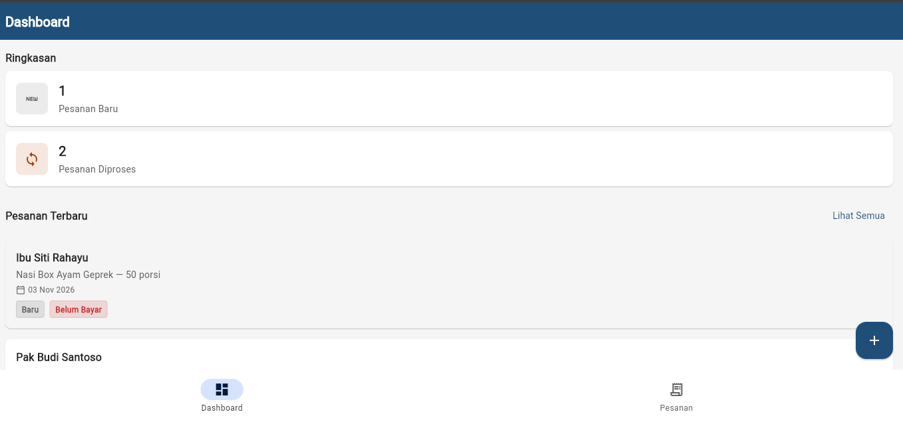
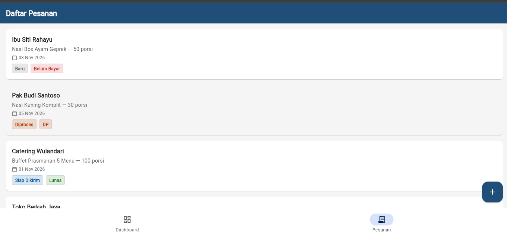
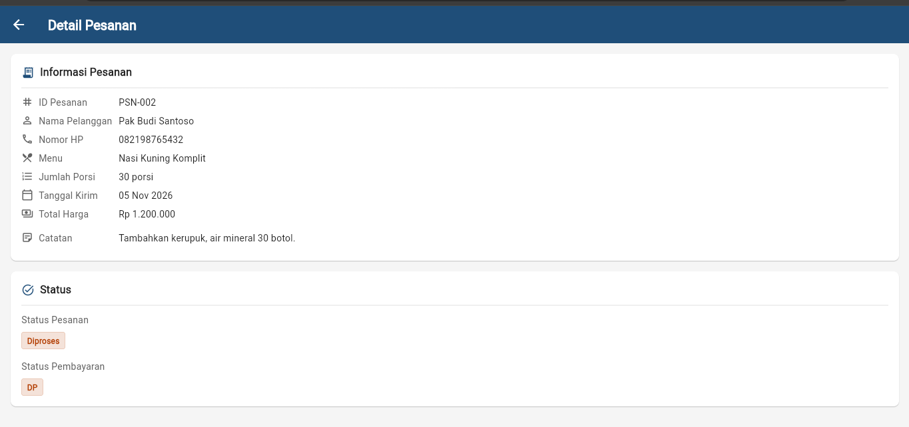

# KelolaKatering

Aplikasi pencatatan pesanan katering untuk UMKM katering berbasis Flutter.
Membantu pemilik usaha katering mencatat dan memantau pesanan serta status
pembayaran dalam satu aplikasi, menggantikan pencatatan manual via WhatsApp
atau buku/catatan terpisah.

## Fitur yang Sudah Diimplementasikan

- **Dashboard** — menampilkan ringkasan jumlah pesanan baru dan pesanan
  diproses, serta daftar 3 pesanan terbaru.
- **Daftar Pesanan** — menampilkan seluruh pesanan dalam bentuk kartu
  dengan informasi nama pelanggan, menu, jumlah porsi, tanggal kirim,
  status pesanan, dan status pembayaran.
- **Detail Pesanan** — menampilkan informasi lengkap satu pesanan meliputi
  ID, nama pelanggan, nomor HP, menu, jumlah porsi, tanggal kirim, total
  harga, catatan, status pesanan, dan status pembayaran.
- **Navigasi antar halaman** — Dashboard dan Daftar Pesanan terhubung
  melalui NavigationBar (Material 3); kartu pesanan dapat ditekan untuk
  membuka halaman Detail Pesanan.
- **Empty state** — menampilkan ilustrasi dan pesan ketika tidak ada
  data pesanan.
- **Data simulasi** — 5 pesanan fiktif sebagai data contoh (tidak
  menggunakan database atau layanan eksternal).

### Status Pesanan

| Status | Keterangan |
|--------|------------|
| Baru | Pesanan baru masuk |
| Diproses | Pesanan sedang diproses/dimasak |
| Siap Dikirim | Pesanan siap untuk dikirim |
| Selesai | Pesanan selesai dan telah dikirim |

### Status Pembayaran

| Status | Keterangan |
|--------|------------|
| Belum Bayar | Pembayaran belum diterima |
| DP | Uang muka / DP diterima |
| Lunas | Pembayaran lunas |

## Teknologi yang Digunakan

- **Flutter** (Dart) — framework UI cross-platform
- **Material 3** — sistem desain dengan ColorScheme kustom
- **Warna primer:** #1F4E79 (biru navy)
- **Tidak menggunakan Firebase** — data berasal dari simulasi in-memory
- **Tidak menggunakan package pihak ketiga** — hanya Flutter SDK dan
  `cupertino_icons`
- **Tanpa package `intl`** — format tanggal dan rupiah diimplementasikan
  manual

## Struktur Proyek

```
lib/
  main.dart                          # Entry point + HomeShell (NavigationBar)
  data/
    mock_data.dart                   # Data simulasi 5 pesanan
  models/
    pesanan_model.dart               # Model Pesanan + enum status
  screens/
    dashboard_screen.dart            # Halaman Dashboard
    daftar_pesanan_screen.dart       # Halaman Daftar Pesanan
    detail_pesanan_screen.dart       # Halaman Detail Pesanan
  utils/
    theme.dart                       # Tema Material 3 (AppTheme)
  widgets/
    summary_card.dart                # Kartu ringkasan jumlah
    status_badge.dart                # Badge status pesanan/pembayaran
    empty_state.dart                 # Tampilan kosong
    pesanan_card.dart                # Kartu pesanan
```

## Cara Menjalankan Aplikasi

1. Pastikan Flutter SDK sudah terinstal (`flutter --version`).
2. Buka terminal di folder proyek.
3. Jalankan perintah berikut:

```bash
flutter pub get
flutter run
```

4. Pilih perangkat target (Chrome, Windows, Android emulator, dll).

### Menjalankan di Web (Chrome)

```bash
flutter run -d chrome
```

### Menjalankan di Desktop (Windows)

```bash
flutter run -d windows
```

## Analisis Kode

Untuk memeriksa kualitas kode:

```bash
flutter analyze
```

Hasil: **No issues found!**

## Screenshot

### Dashboard



### Daftar Pesanan



### Detail Pesanan



## Repository

https://github.com/putriatri0011/KelolaKatering
